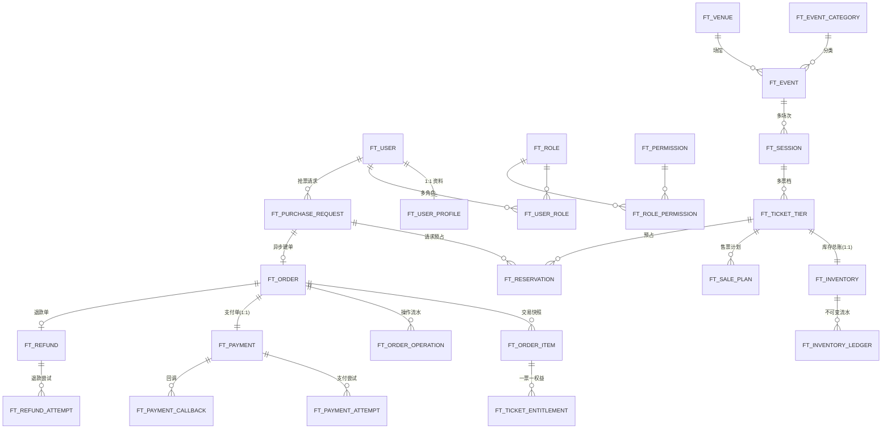

# FlashTicket 数据模型与 ER 图（M17-05）

> 生成时间：2026-10-16 · 由 Flyway `V1~V17` 迁移脚本盘点，共 **48 张 `ft_` 表**
> 完整字段级设计见 `doc/全局数据库模型与ER关系设计.md`（61 KB）与 `doc/全局逻辑ER模型.md`（315 KB），本文提供核心交易域 ER 图 + 全量表清单速查。

---

## 1. 核心交易域 ER 图

覆盖「账号 → 活动/库存 → 抢票/订单 → 支付/权益/退款」主干关系：

**关键约束：**
- `ft_inventory.tier_id` 是主键，守恒 `total = available + reserved + sold`；扣减用手写条件更新 `WHERE available>=q AND version=?` 判受影响行数（不用 `@Version` 插件）。
- `ft_reservation.request_id` 幂等；`ft_order_item` 为下单时交易快照，不受后续改价影响。
- `ft_ticket_entitlement` 唯一约束 `UNIQUE(order_item_id, ticket_index)`，一票一权益。

---

## 2. 全量表清单（48 表，按域）

### 2.1 identity（账号 / RBAC）— 7 表

| 表 | 说明 |
|---|---|
| `ft_user` | 用户账号（邮箱唯一，雪花主键） |
| `ft_user_profile` | 用户资料（1:1） |
| `ft_role` | 角色（USER/OPERATOR/FINANCE/ADMIN/SUPER_ADMIN） |
| `ft_permission` | 权限点（`{域}:{资源}:{动作}`） |
| `ft_user_role` | 用户-角色关联 |
| `ft_role_permission` | 角色-权限关联（种子全局递增不重叠） |
| `ft_operation_audit` | 后台操作审计日志 |

### 2.2 event（活动域）— 7 表

| 表 | 说明 |
|---|---|
| `ft_event_category` | 演出分类（不物理删除，ENABLED/DISABLED） |
| `ft_venue` | 场馆 |
| `ft_event` | 演出活动（DRAFT→PENDING_REVIEW→APPROVED→PUBLISHED） |
| `ft_session` | 场次（SCHEDULED→POSTPONED→CANCELLED） |
| `ft_ticket_tier` | 票档（价格/库存配置） |
| `ft_sale_plan` | 售票计划（窗口/限购） |
| `ft_event_review` | 审核记录（SHA-256 配置指纹，审核人≠提交人） |

### 2.3 inventory（库存）— 4 表

| 表 | 说明 |
|---|---|
| `ft_inventory` | 库存总账（tier_id 主键，守恒） |
| `ft_reservation` | 预占（request_id 幂等） |
| `ft_inventory_ledger` | 不可变库存流水 |
| `ft_purchase_limit` | 用户限购 |

### 2.4 purchase / order（抢票与订单）— 4 表

| 表 | 说明 |
|---|---|
| `ft_purchase_request` | 抢票请求（QUEUED/PROCESSING/RECOVERING/SUCCEEDED/FAILED/CANCELLED） |
| `ft_order` | 订单（PENDING_PAYMENT→PAID/CLOSED） |
| `ft_order_item` | 订单明细（交易快照） |
| `ft_order_operation` | 订单操作流水 |

### 2.5 payment / entitlement（支付与权益）— 4 表

| 表 | 说明 |
|---|---|
| `ft_payment` | 支付单（order_id 唯一） |
| `ft_payment_attempt` | 支付尝试 |
| `ft_payment_callback` | 支付回调 |
| `ft_ticket_entitlement` | 票务权益（一票一权益） |

### 2.6 refund（退款）— 2 表

| 表 | 说明 |
|---|---|
| `ft_refund` | 退款业务单（PENDING_REVIEW→APPROVED→PROCESSING→SUCCEEDED/FAILED） |
| `ft_refund_attempt` | 退款尝试 |

### 2.7 coupon（营销）— 8 表

| 表 | 说明 |
|---|---|
| `ft_campaign` | 营销活动 |
| `ft_coupon_template` | 券模板 |
| `ft_coupon_ledger` | 额度账本 |
| `ft_coupon_quota` | 活动额度 |
| `ft_coupon_claim_request` | 领券请求 |
| `ft_user_coupon` | 用户券 |
| `ft_coupon_usage` | 核销记录 |
| `ft_coupon_user_quota` | 用户限领 |

### 2.8 notification（通知）— 2 表

| 表 | 说明 |
|---|---|
| `ft_notification` | 站内消息内容 |
| `ft_notification_recipient` | 接收人（UNIQUE(notification_id,user_id)，read_at 空=未读） |

### 2.9 risk（风控）— 3 表

| 表 | 说明 |
|---|---|
| `ft_risk_rule` | 风控规则 |
| `ft_risk_restriction` | 限制/黑名单（scope PURCHASE/CLAIM/LOGIN/ALL） |
| `ft_risk_operation` | 风控审计 |

### 2.10 reconciliation（对账与补偿）— 5 表

| 表 | 说明 |
|---|---|
| `ft_reconcile_job` | 对账任务 |
| `ft_reconcile_report` | 对账报告 |
| `ft_reconcile_exception` | 异常工单（OPEN→INVESTIGATING→RESOLVED→CLOSED） |
| `ft_reconcile_action` | 工单处理动作 |
| `ft_compensation_task` | 补偿任务（PENDING→RUNNING→SUCCEEDED/RETRY_WAIT/MANUAL_REVIEW/FAILED） |

### 2.11 messaging（消息基础设施）— 2 表

| 表 | 说明 |
|---|---|
| `ft_outbox_event` | Outbox（受理与事件同事务，PENDING→SENT 领租约补发） |
| `ft_message_inbox` | Inbox（UNIQUE(consumer_name,event_id) 消费幂等） |

---

## 3. 全局工程约定

- **命名**：`ft_` 前缀；主键雪花 BIGINT（前端 String）；金额 BIGINT 分；时间 DATETIME(3) UTC。
- **迁移**：Flyway 跟随业务（V1 空基线，V2~V17 逐里程碑追加表）。
- **字段填充**：`MetaObjectHandler` 只自动填 `createdAt/updatedAt`；NOT NULL 的自定义时间字段（如 `received_at`）需业务显式 set。
- **扩展枚举**：`ft_order_operation` 的 CHECK 约束扩展需 `DROP CHECK` 再 `ADD`。
