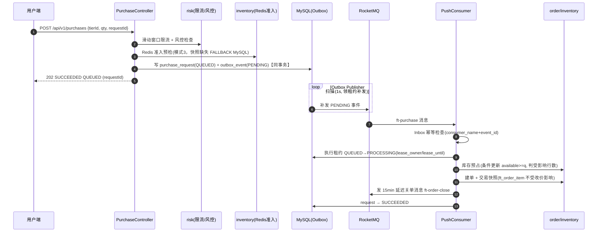
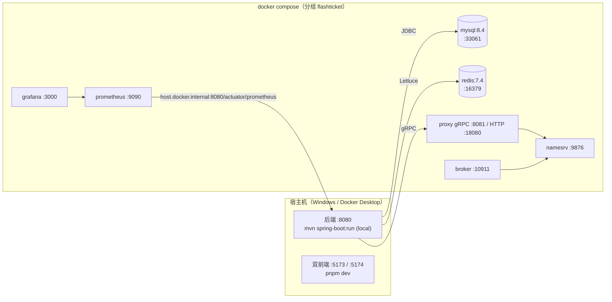

# FlashTicket 系统架构图（M17-05）

> 生成时间：2026-10-16 · 架构形态：**模块化单体（Modular Monolith）** + Vue3 双前端 + RocketMQ 异步消息

FlashTicket 不是微服务，而是「单 Maven 工程、按领域分包」的模块化单体。跨域协作通过**编排服务 → 领域服务接口**约束，禁止跨域直调 Mapper。高并发抢票的异步化与可靠性靠 RocketMQ + Outbox/Inbox 事务消息落地。

---

## 1. 系统分层架构

```mermaid
flowchart TB
    subgraph Client["客户端层"]
        TW["用户端 ticket-web<br/>Vue3 + TS + Vite + Naive UI + Tailwind<br/>:5173"]
        AW["管理端 admin-web<br/>Vue3 + TS + Vite + Element Plus + SCSS<br/>:5174"]
    end

    subgraph Edge["接入 / 交付层"]
        NG["Nginx（生产）<br/>ticket-web → /<br/>admin-web → /admin/<br/>API 反代 → :8080<br/>actuator 透传"]
    end

    subgraph App["后端 · 模块化单体 Spring Boot 3.5 / Java 21"]
        direction TB
        subgraph Orch["编排服务层（跨域事务编排）"]
            PC["purchase 抢票编排"]
            PM["payment 支付编排"]
            RF["refund 退款编排"]
        end
        subgraph Domain["领域服务层"]
            ID["identity 账号 / 认证 / RBAC"]
            EV["event 分类·场馆·活动·场次·票档·审核"]
            INV["inventory 库存总账·预占·流水·限购"]
            ORD["order 订单·明细·关单"]
            ENT["entitlement 票务权益"]
            CPN["coupon 优惠券·营销"]
            NT["notification 站内消息·SSE"]
            RK["risk 限流·风控·黑名单"]
            AN["analytics 运营统计"]
            RC["reconciliation 对账·补偿"]
        end
        subgraph Infra["基础设施层"]
            MSG["messaging Outbox / Inbox / 租约"]
            CMM["common 响应信封·错误码·安全·请求标识"]
        end
        Orch --> Domain
        Domain --> Infra
    end

    subgraph Data["数据与中间件"]
        MySQL[("MySQL 8.4 · :33061<br/>权威账本（ft_ 48 表）")]
        Redis[("Redis 7.4 · :16379<br/>会话·限流·库存准入快照")]
        MQ[("RocketMQ 5.3 · proxy gRPC :8081<br/>ft-purchase / ft-order-close / ft-notification")]
    end

    Client --> NG
    NG --> App
    App --> Data
```

**分层约束（M00 契约）：**
- HTTP 层只做参数绑定与权限（`@PreAuthorize`），业务语义全在 `code`（统一响应信封）。
- 编排服务（purchase/payment/refund）是唯一可跨域调用领域服务的入口。
- 领域服务之间不互相调 Mapper，只依赖接口。

---

## 2. 后端领域模块总览

| 模块 | 职责 | 关键表 | 权限点 |
|---|---|---|---|
| `common` | 响应信封 / 错误码 / 全局异常 / 请求标识 / 安全配置 | — | — |
| `system` | 健康检查（liveness / readiness） | — | — |
| `identity` | 注册·邮箱验证·登录·刷新·个人中心·后台 RBAC | ft_user / ft_user_profile / ft_role / ft_permission / ft_user_role / ft_role_permission | — |
| `event` | 分类·场馆·活动·场次·票档·售票计划·审核发布 | ft_event_category / ft_venue / ft_event / ft_session / ft_ticket_tier / ft_sale_plan / ft_event_review | 201–226 |
| `inventory` | 库存总账·预占·流水·限购·Redis 准入 | ft_inventory / ft_reservation / ft_inventory_ledger / ft_purchase_limit | — |
| `purchase` | 抢票受理（异步 Outbox）·查询·取消 | ft_purchase_request | 233 / 234 |
| `order` | 订单·明细·操作流水·关单 | ft_order / ft_order_item / ft_order_operation | — |
| `payment` | 支付·mock 支付·回调·支付尝试 | ft_payment / ft_payment_attempt / ft_payment_callback | — |
| `entitlement` | 票务权益（一票一权益） | ft_ticket_entitlement | — |
| `refund` | 退款业务单·审核·重试 | ft_refund / ft_refund_attempt | — |
| `coupon` | 营销活动·模板·额度·领券·锁券·核销·返券 | ft_campaign / ft_coupon_template / ft_coupon_ledger / ft_coupon_quota / ft_coupon_claim_request / ft_user_coupon / ft_coupon_usage / ft_coupon_user_quota | — |
| `risk` | 滑动窗口限流·风控规则·黑名单·审计 | ft_risk_rule / ft_risk_restriction / ft_risk_operation | 243–247 |
| `notification` | 站内消息·接收人·SSE 实时推送 | ft_notification / ft_notification_recipient | 240–242 |
| `analytics` | 运营看板（实时 SQL 聚合，不建汇总表） | （只读） | 248–249 |
| `reconciliation` | 四领域对账·异常工单·补偿任务 | ft_reconcile_job / ft_reconcile_report / ft_reconcile_exception / ft_reconcile_action / ft_compensation_task | 250–254 |
| `messaging` | Outbox / Inbox 事务消息·执行租约·补发 | ft_outbox_event / ft_message_inbox | — |

---

## 3. 异步抢票核心链路（时序图）

M12 起抢票从同步改为**异步**：受理同事务落 Outbox，消费者建单，三重幂等 + 执行租约 + 延迟关单。

**可靠性保障（M17-03 已实弹演练）：**
- **受理不丢**：Outbox 与请求同事务，MQ 故障时 PENDING 累积，恢复后 Publisher 补发。
- **消费不重**：Inbox `(consumer_name, event_id)` 唯一 + 执行租约双重幂等。
- **恢复三扫**：租约过期→RECOVERING、RECOVERING 到点补发新 eventId、QUEUED 超时→FAILED。

---

## 4. 部署拓扑（本地 Docker Compose）

| 服务 | 宿主端口 | 说明 |
|---|---|---|
| mysql:8.4 | 33061 | 权威账本，utf8mb4，UTC，root/${DB_PASSWORD:-changeme} |
| redis:7.4 | 16379 | 会话 / 限流 / 库存准入快照 |
| namesrv | 9876 | RocketMQ 注册中心 |
| broker | 10911 | 消息存储 |
| proxy | 8081 (gRPC) / 18080 (HTTP) | 后端 v5 客户端连 gRPC 8081 |
| prometheus | 9090 | 抓后端 `/actuator/prometheus` |
| grafana | 3000 | 预置「FlashTicket 运营监控」看板，admin/${GF_SECURITY_ADMIN_PASSWORD:-changeme} |

---

## 5. 生产部署（Nginx 交付参考）

`docker/nginx/nginx.conf` 提供单域交付拓扑：静态资源与 API 同域，规避跨域与双端口暴露。

| 路径 | 上游 |
|---|---|
| `/` | ticket-web 静态资源（SPA fallback → index.html） |
| `/admin/` | admin-web 静态资源 |
| `/api/` | 反代后端 `:8080`（WebSocket/SSE 长连接需 `proxy_buffering off`） |
| `/actuator/` | 后端监控端点（生产建议仅内网放行） |

> 生产还应前置：HTTPS 终结、SSE 的 `proxy_read_timeout` 调大、RocketMQ/Redis/MySQL 改外部高可用实例、JWT 密钥走环境变量。
