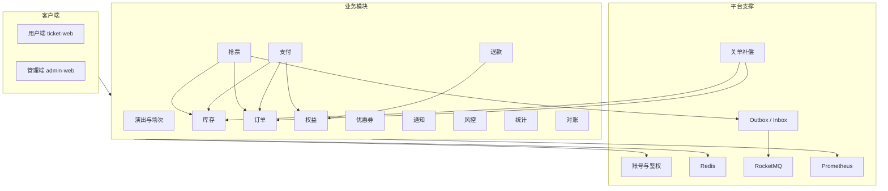
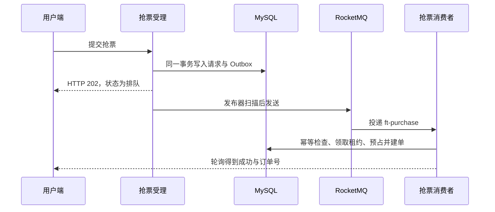
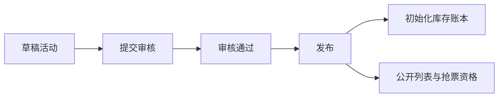
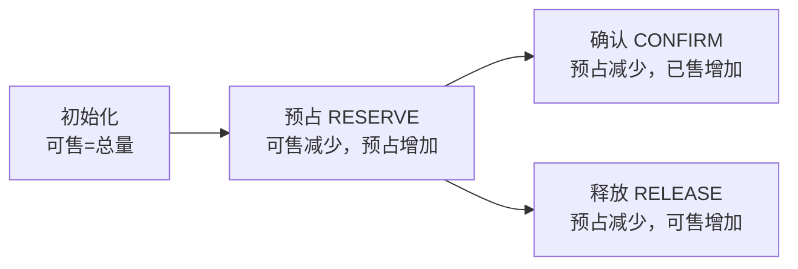
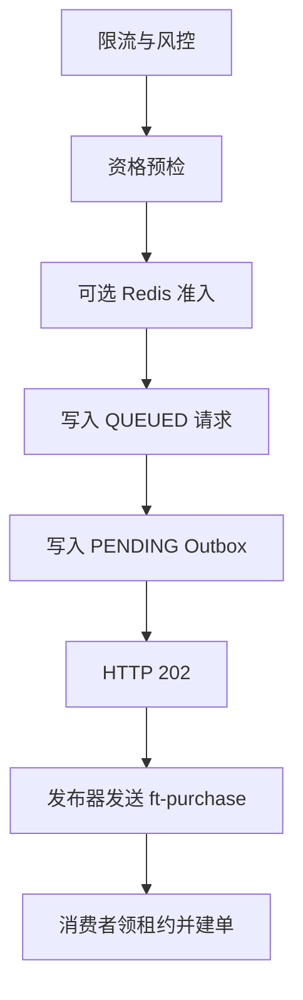
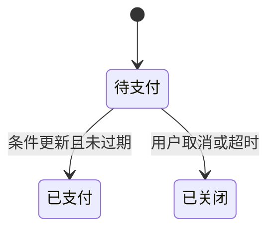
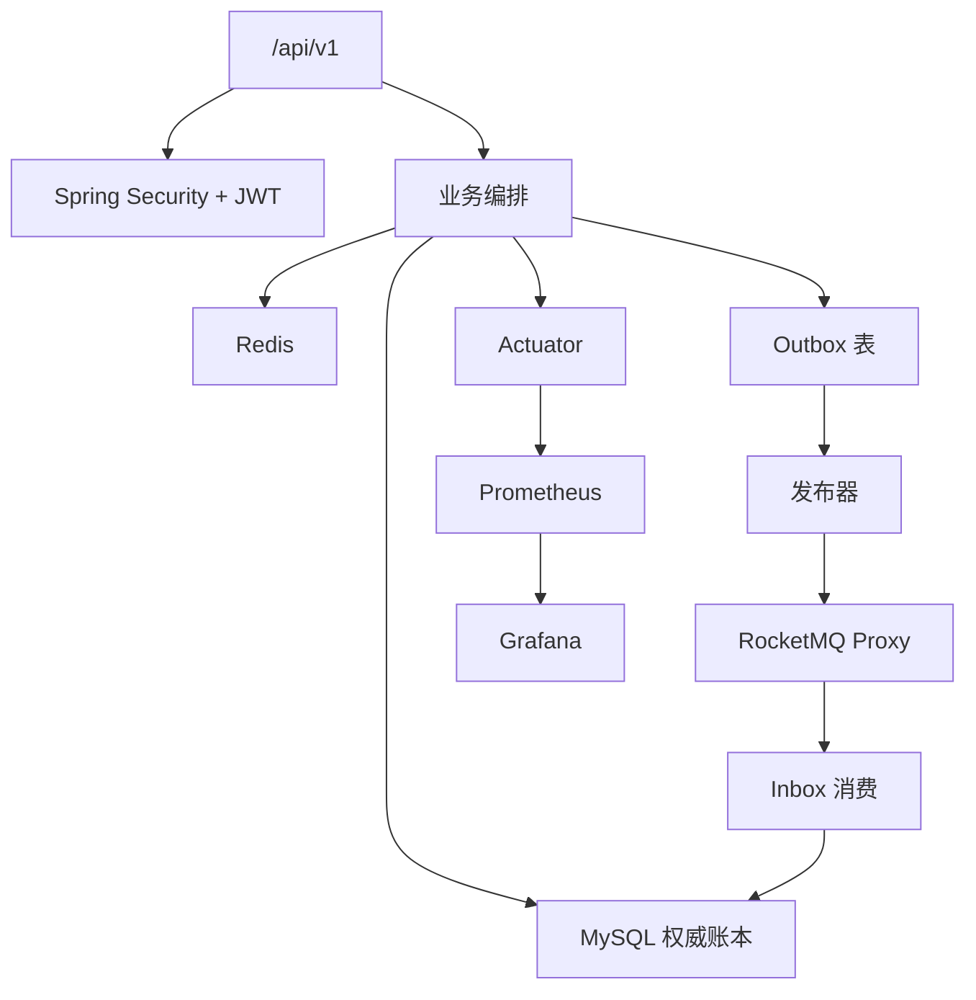
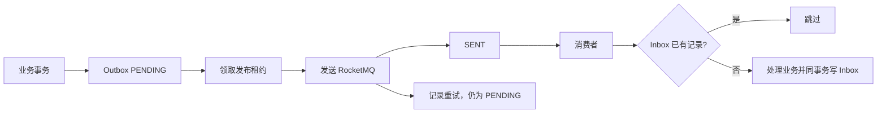
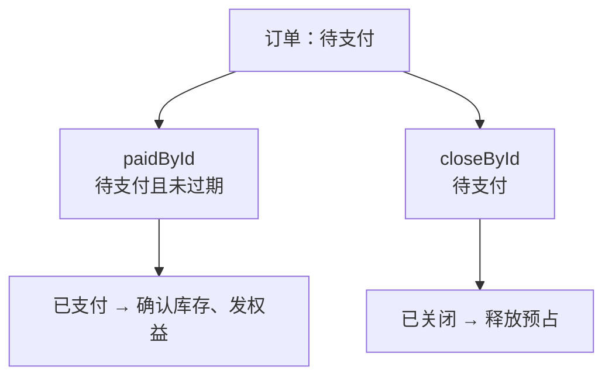

# FlashTicket 系统设计说明书

本文说明 FlashTicket 的系统设计。FlashTicket 是面向演出票务的高并发抢票与订单系统，采用 Java 21 与 Spring Boot 3.5 的模块化单体：一个后端进程按领域分包，用户端与管理端为两个 Vue 3 应用。票档是不指定座位的数量型库存。支付与退款使用进程内模拟渠道 `MOCK_WALLET`，不连接外部支付机构。

本文只描述仓库中已经落地的能力。选座、真实支付网关、通用商品商城不在本系统范围内。连接参数见《中间件使用文档》，演示步骤与面试材料见 `docs/interview/`，不作为正文。

## 概述

### 定位

FlashTicket 解决的是演出开售时的下单问题：大量用户在短时间内对同一票档提交购买请求，系统必须先可靠地收下请求，再在后台完成库存预占和订单创建，并在支付成功与超时关单之间只保留一个合法终态。

产品主路径是：浏览已发布演出，提交抢票，轮询受理结果，对待支付订单做模拟支付，获得票务权益；超时未支付或用户取消则关闭订单并释放预占。运营侧负责演出、场次、票档、售票计划和审核发布。财务侧查看支付与退款。平台侧提供账号、限流、消息、对账和监控。

系统不是微服务，也不是完整电商。跨领域的事务由抢票、支付、退款三个编排服务在同一个 MySQL 里完成。业务包之间不直接调用对方的 Mapper。代码位于 `backend/src/main/java/com/flashticket/`。

### 目标

| 目标 | 说明 |
|---|---|
| 开售请求先被可靠收下 | 抢票接口在受理事务内写入抢票请求和 Outbox，返回 HTTP 202。消息队列短暂不可用时，请求仍留在数据库，恢复后由发布器补发。 |
| 库存不超卖、不重复释放 | 可售、预占、已售三态由条件更新维护。扣减是否成功以受影响行数为准，不采用先读后写。 |
| 支付与关单互斥 | 订单从待支付只能进入已支付或已关闭。两条更新都要求当前状态仍为待支付，同一行上只有一方成功。 |
| 重复请求不重复产生订单和门票 | 抢票以客户端请求号幂等，消费以 Inbox 和执行租约幂等，支付以尝试请求号幂等。 |
| 过程可以观察 | 健康检查区分存活与就绪。Actuator 暴露 Prometheus 指标，由本仓库的 Prometheus 与 Grafana 抓取和展示。 |

### 适用角色

| 角色 | 核心诉求 | 主要功能 |
|---|---|---|
| 购票用户（USER） | 在开售窗口内提交请求、付款、查看门票、申请退款 | 抢票、订单、模拟支付、权益、退款申请、站内消息 |
| 运营人员（OPERATOR） | 维护演出资料并推动审核 | 分类、场馆、活动、场次、票档、售票计划、提交审核 |
| 财务人员（FINANCE） | 核对收款与退款 | 支付查询、退款审核、对账查看 |
| 系统管理员（ADMIN） | 管理后台账号与权限范围内的配置 | 员工、角色、审计 |
| 超级管理员（SUPER_ADMIN） | 审核发布、权限分配和补偿操作 | 审核、发布、角色权限、对账补偿 |

后台接口使用 `@PreAuthorize`，权限码形式为「域:资源:动作」。后台登录除了 JWT 合法，还要求账号具备有效的后台角色。

### 技术选型

后端为单 Maven 工程。`backend/pom.xml` 锁定 Java 21、Spring Boot 3.5.6、MyBatis-Plus 3.5.12。复杂并发语句写在 Mapper 注解中，不使用 MyBatis-Plus 的 `@Version` 插件。数据库迁移使用 Flyway，脚本为 `V1` 至 `V17`。

数据与消息如下。MySQL 8.4 是权威账本，表前缀 `ft_`，金额以分为单位，业务时间使用 UTC 的 `DATETIME(3)`。Redis 7.4 存放刷新会话、邮箱验证码、滑动窗口限流计数，以及可选的库存准入快照。RocketMQ 5.3 通过 Proxy 的 gRPC 端口接入，客户端为 `rocketmq-v5-client-spring-boot-starter` 2.3.6。三个业务主题为 `ft-purchase`、`ft-order-close`、`ft-notification`。

前端是 pnpm workspace 中的两个 Vue 3 应用。用户端 `apps/ticket-web` 使用 Naive UI 与 Tailwind，开发端口 5173。管理端 `apps/admin-web` 使用 Element Plus，开发端口 5174。端到端冒烟使用 Playwright，压测脚本为 JMeter 的 `e2e/loadtest/checkout.jmx`。本地中间件由 `docker-compose.yml` 编排，项目名 `flashticket`。

身份认证使用 RS256 JWT。访问令牌默认 15 分钟，刷新令牌放在 HttpOnly Cookie 中，不出现在响应正文。私钥文件不进入版本库。

## 整体功能架构

系统分为客户端、业务模块和平台支撑三层。客户端只通过 `/api/v1` 访问后端。业务模块负责演出、库存、抢票、订单、支付、权益、退款、优惠券、通知、风控、统计和对账。平台支撑提供账号、缓存、消息、事务消息、关单和监控，供上述模块复用。

图 2-1 系统总体功能架构

抢票不在 HTTP 线程里完成扣库存和建单。受理接口只做资格预检、限流和落库，随后由 Outbox 发布器把事件送到 RocketMQ，再由消费者在独立事务中预占库存并创建待支付订单。用户看到的「排队成功」只表示请求已被收下。只有轮询状态变为成功时，才存在订单。

图 2-2 异步抢票主链路

| 模块 | 代码包 | 核心定位 | 关键输出 |
|---|---|---|---|
| 演出与场次 | `event` | 维护可售卖的活动、场次和票档 | 已发布场次、票档、售票时间窗 |
| 库存 | `inventory` | 维护可售、预占、已售 | 预占记录、库存流水 |
| 抢票 | `purchase` | 受理并异步建单 | 排队状态、订单 |
| 订单 | `order` | 管理交易生命周期 | 待支付、已支付、已关闭 |
| 支付 | `payment` | 模拟收款并确认交易 | 支付单、支付尝试 |
| 权益 | `entitlement` | 付款后发放门票 | 票务权益 |
| 退款 | `refund` | 对已支付订单做全额逆向 | 退款单、权益撤销 |
| 优惠券 | `coupon` | 领券、锁券、核销和退回 | 用户券、优惠金额 |
| 通知 | `notification` | 把交易结果变成站内消息 | 消息、SSE |
| 风控 | `risk` | 限制突发请求和受限账号 | 限流结果、限制记录 |
| 统计 | `analytics` | 按活动汇总经营数据 | 只读统计 |
| 对账 | `reconciliation` | 发现账实差异并登记补偿 | 对账报告、补偿任务 |

统一响应信封为 `code`、`message`、`data`、`requestId`、`traceId`、`timestamp`。HTTP 状态表示传输结果，`code` 表示业务结果。雪花主键在接口中以字符串传输，避免前端精度丢失。

## 模块设计

### 3.1 演出与场次

#### 3.1.1 功能定位

演出与场次模块负责「卖什么、在哪里卖、何时开卖」。它维护分类、场馆、活动、场次、票档、售票计划和审核记录，对应包 `event`。本模块不直接扣减库存。票档发布时由库存模块初始化账本，开售资格由抢票编排在受理和建单时复检。

活动从草稿开始，经过提交审核、审核通过和发布后才对公众可见。审核人与提交人必须不是同一账号，避免同一人既编写又放行。

#### 3.1.2 核心目标

演出资料与交易数据分离。改价或改文案不应回溯已生成的订单明细，订单在创建时保存交易快照。

发布是售票的起点。未发布的活动不能出现在公开列表中，也不能进入抢票资格校验。

售票计划只表达时间窗。开售与结束时间决定用户此刻能否购买，库存数量仍由库存账本决定。

#### 3.1.3 架构设计

管理端接口位于 `/api/v1/admin` 下的分类、场馆、活动、场次和票档资源。公开查询只返回已发布活动和处于可展示状态的场次与票档，包括余量查询 `GET /api/v1/tiers/{id}/availability`。

图 3-1 演出从草稿到可售

#### 3.1.4 子功能详细设计

**分类与场馆。** 分类提供稳定的业务码，场馆保存城市、地址和核定容量。场次的可售容量不能超过场馆容量。分类和场馆可以停用，不在本模块做物理删除。

**活动、场次与票档。** 活动包含标题、封面、详情、主办方和观演须知，发布前这些内容按审核规则校验。场次绑定场馆和开演时间。票档保存单价（分）、初始数量以及每单、每人的购买限制。票档主键在库存账本中作为 `tier_id` 使用。

**售票计划。** 每个票档配置开售时间与结束时间，区间为左闭右开。时间变更会增加售票版本，供抢票侧识别配置是否已过期。计划只回答「现在能不能卖」，不回答「还剩几张」。

**审核与发布。** 运营人员提交审核，具备审核权限的另一账号给出通过或驳回。驳回必须填写意见。发布成功后活动进入公众可见状态，并触发库存初始化。暂停与恢复售票作用在票档上，不删除已产生的订单。

### 3.2 库存与票档预占

#### 3.2.1 功能定位

库存模块是防超卖的最终边界，包名为 `inventory`。一张票档对应一行总账 `ft_inventory`，主键即票档标识。账本保持：

总库存 = 可售 + 预占 + 已售。

该等式由迁移 `V7__inventory_reservation_ledger_limit.sql` 中的检查约束 `chk_inv_conservation` 保存，各列另有非负约束。其他模块只能调用 `InventoryService` 的初始化、预占、确认和释放，不能自行更新这四列。

#### 3.2.2 核心目标

并发下单时，多个请求不能把同一张可售票各记一次。扣减必须在数据库语句的条件中完成。

下单只形成预占，付款才变成已售，取消或超时把预占还回可售。已确认的预占不能再按普通释放加回可售。

同一抢票请求号重复执行时，返回原预占，不第二次扣减。确认和释放重复执行时，按已经到达的终态返回。

#### 3.2.3 架构设计

`InventoryMapper` 提供三条条件更新。`reserve` 在 `available >= 数量` 时减少可售、增加预占。`confirm` 在 `reserved >= 数量` 时减少预占、增加已售。`release` 在 `reserved >= 数量` 时减少预占、增加可售。三条语句都把 `version` 加一，但 `version` 不出现在 `WHERE` 中，因此不依赖乐观锁插件重试。成功与否看受影响行数：预占得到 0 行时返回可售不足。

图 3-2 库存三态转换

Redis 准入是可选的入口预检，配置项 `flashticket.inventory.redis-admission.enabled` 默认为关闭。关闭时抢票直接以 MySQL 为权威。打开时，快照显示不足可以在受理阶段拒绝；快照缺失或 Redis 异常则回退 MySQL，不阻断受理。预检不能代替 `reserve`。

#### 3.2.4 子功能详细设计

**初始化。** 发布票档时写入总库存和可售，预占与已售为 0。已存在的账本直接返回。并发插入命中主键时忽略重复，避免发布重试把库存加两次。流水操作名为 `INIT`。

**预占。** `InventoryService.reserve` 在同一事务中完成四步：按请求号查找已有预占；条件扣减可售；以 `SELECT … FOR UPDATE` 占用限购行，使已预占加已售再加本次数量不超过票档的每人限购；插入状态为 `RESERVED` 的预占并写 `RESERVE` 流水。请求号在预占表上唯一，用于挡住同一请求的并发双插。

**确认与释放。** 预占行只有处于 `RESERVED` 时才能改为 `CONFIRMED` 或 `RELEASED`。状态条件更新的受影响行数为 0 时，服务重读记录：已经是目标终态则幂等返回，否则视为非法转换。库存行和限购行在状态转换成功之后才移动。确认把限购从预占计为已售，释放则减少预占数量。流水分别为 `CONFIRM` 和 `RELEASE`。

**查询。** 后台可按票档读取总账、预占列表和流水，权限为 `inventory:read`。公开余量接口只展示可售状态所需的信息，不暴露预占明细。

### 3.3 抢票受理

#### 3.3.1 功能定位

抢票模块是交易入口，包名为 `purchase`。它接收用户的票档、数量和客户端请求号，在受理成功时返回 HTTP 202 和排队状态。它不保证用户一定买到票。是否买到，由消费者执行库存预占和建单之后的请求状态决定。

把建单留在 HTTP 请求里，会使开售流量直接打在库存行上，并且进程在响应前崩溃时难以区分「扣了库存」和「用户没拿到结果」。当前设计把「已经收下」写成数据库事实，把「已经处理」留给可重试的消费者。

#### 3.3.2 核心目标

受理与 Outbox 同行提交，避免出现「用户已看到排队，库里却没有请求」或相反的裂缝。

同一请求号重复提交只返回已有状态，不新增第二条排队记录。

消费者崩溃、消息重复或消息队列短暂不可用时，请求能够进入恢复，并且不会生成两张订单。

排队超过受理截止时间仍未被处理时，请求进入失败，而不是永远停在排队。

#### 3.3.3 架构设计

`PurchaseController` 提供提交、查询、列表和取消。提交始终以 HTTP 202 返回 `ApiResponse`。新请求的 `data.status` 为 `QUEUED`，`order` 为空。状态枚举还包括处理中、恢复中、成功、失败和已取消。

图 3-3 抢票受理与建单

受理前的检查用于快速拒绝明显无效的请求，不代替库存条件更新。限流键按账号和票档，默认 5 秒内 1 次新请求，重复的同一请求号在限流之前返回。被临时限制的用户不能提交。资格预检确认场次、票档和售票时间窗，并得到建单所需的快照。

#### 3.3.4 子功能详细设计

**可靠受理。** `PurchaseCheckoutService.accept` 在一个本地事务中插入 `ft_purchase_request` 和 `ft_outbox_event`。事件类型为 `PURCHASE_SUBMITTED`，主题默认 `ft-purchase`，载荷只包含事件号和请求号。受理截止时间默认为当前时间之后 60 秒。

**异步建单。** `PurchaseRequestListener` 消费组为 `ft-purchase-cg`。`PurchaseRequestProcessor` 先查 Inbox，再领取处理租约，把排队或恢复中的请求改为处理中。`PurchaseOrderBuilder` 在同一事务中预占库存、按需锁券、创建订单、把请求标为成功，并写入 Inbox。租约已经不属于当前处理者时，整笔事务回滚。

**查询与取消。** 用户只能查询和取消自己的请求。取消仅允许仍处于排队的请求。成功之后的订单取消走订单模块，不走抢票取消。

**恢复。** `PurchaseRecoveryScanner` 处理三类未完成请求：处理中但租约已过期、到达重试时间的恢复中请求、超过受理截止仍在排队的请求。前两类补发新的事件号并保留原请求号，排队超时则记为失败，原因 `QUEUE_TIMEOUT`。订单和预占上的请求号唯一约束保证补发不会产生第二张订单。

### 3.4 订单

#### 3.4.1 功能定位

订单模块记录一笔抢票成功之后的交易，包名为 `order`。订单只表达交易生命周期：待支付、已支付、已关闭。退款不把订单改回待支付，也不另设「已退款」作为订单主状态。

订单在创建时复制票档价格、数量和优惠结果。此后票档改价不影响该订单的应付金额。

#### 3.4.2 核心目标

每一笔成功的抢票请求最多对应一张订单。请求号在订单上唯一。

待支付订单必须带支付期限。期限默认从创建时刻起 15 分钟，配置项为 `flashticket.order.payment-timeout-minutes`。

关闭订单和确认支付必须使用同一套状态条件，避免一边释放库存、一边发出门票。

#### 3.4.3 架构设计

用户接口包括订单列表、详情、取消和操作流水。管理端按状态、订单号和用户查询。创建订单不单独暴露给前端，只由抢票建单事务调用 `OrderService.createOrder`。

图 3-4 订单状态

#### 3.4.4 子功能详细设计

**创建与快照。** 建单写入订单头和明细，状态为 `PENDING_PAYMENT`，并记录过期时间。若使用了优惠券，订单保存券标识、优惠金额和规则快照。同时写入一条订单创建操作流水。

**用户取消。** `POST /api/v1/orders/{orderId}/cancel` 校验归属后进入 `OrderCloseService`。只有待支付可以取消。已经关闭的订单再次取消时直接返回，不重复释放库存。

**支付确认。** 支付模块调用 `OrderService.markPaid`。该方法要求订单仍为待支付且未过期，成功后写入支付时间和支付金额。订单模块不自己发放门票，发放由支付编排继续调用权益模块。

**操作流水。** `ft_order_operation` 记录从哪个状态到哪个状态、操作类型和操作者。支付确认、用户取消和超时关闭各自有对应的操作类型，供客服和面试时对照账本。

### 3.5 支付

#### 3.5.1 功能定位

支付模块把待支付订单推进到已支付，包名为 `payment`。当前渠道固定为 `MOCK_WALLET`：服务在本地事务中模拟渠道成功，并写入一条支付回调记录，用于表达「渠道事件只处理一次」。这里没有对公网开放的第三方支付回调地址，也不能由前端在请求里声明支付已经成功或改写金额。

金额以订单应付金额为准。一笔订单对应一张支付单，表上对订单号唯一。

#### 3.5.2 核心目标

重复点击支付不会重复确认库存和重复发券。

支付当时订单已经被关掉，或支付期限已过，则确认失败，库存保持在可释放或已释放的状态。

支付成功时，订单状态、库存确认、优惠券核销、权益发放和支付单状态在同一本地事务中提交。

#### 3.5.3 架构设计

接口为创建或获取支付单 `POST /api/v1/orders/{orderId}/payments`、查询支付单，以及模拟支付 `POST /api/v1/payments/{paymentId}/mock-pay`。模拟支付的请求体只有 `attemptRequestId`。

确认顺序在 `PaymentService.confirm` 中固定：先抢到订单的已支付状态，再确认库存、核销优惠券、发放权益，最后把支付单和本次尝试标为成功。任一步失败则整笔事务回滚。

#### 3.5.4 子功能详细设计

**创建支付单。** 若该订单已有支付单，校验归属后返回原单。否则要求订单属于当前用户、状态为待支付且未过期，再插入状态为 `CREATED` 的支付单。并发创建命中唯一约束时重查返回。

**模拟执行。** 支付单已成功则直接返回。已关闭或已失败则拒绝。`createAttempt` 按 `attempt_request_id` 查找，已存在则不再确认。新尝试写入 `ft_payment_attempt`，并写一条已处理的模拟回调，回调以渠道加渠道事件号去重。

**确认结果。** 订单条件更新受影响行数为 1 时，调用库存确认和权益发放。受影响行数为 0 时返回「订单已关闭」，不确认库存。支付成功还会在同一事务写入通知 Outbox，由通知模块异步生成站内消息。

### 3.6 票务权益

#### 3.6.1 功能定位

权益模块表示用户已经买到的票，包名为 `entitlement`，表为 `ft_ticket_entitlement`。一张订单明细按购买数量生成对应数量的权益，权益号唯一。它不负责扣库存，只在支付确认已经成功之后由支付编排调用 `EntitlementService.issue`。

#### 3.6.2 核心目标

支付成功后，用户能够按订单查询到自己的门票。

同一订单重复进入发放逻辑时，不凭空多出一组门票。发放与订单明细上的票序号建立唯一约束。

退款成功后权益变为撤销，但本版本不因此把已售库存自动加回可售。

#### 3.6.3 架构设计

用户接口为 `GET /api/v1/entitlements` 和单张详情。发放入口不对外公开，只接受支付编排传入的订单、用户和明细。

#### 3.6.4 子功能详细设计

**发放。** 支付事务在订单变为已支付、库存确认之后调用发放。数量来自订单明细，而不是来自客户端再次传入的数字。

**查询。** 列表和详情都校验权益属于当前用户。雪花标识以字符串返回。

**撤销。** 退款编排在模拟退款成功时把权益标为撤销。订单保持已支付，库存的已售列保持不变。若业务上需要回补库存，那是后续补偿或独立回补流程，不是本次退款事务的默认动作。

### 3.7 退款

#### 3.7.1 功能定位

退款模块处理已支付订单的全额逆向，包名为 `refund`。它是一笔新的业务单，不删除原支付记录，也不修改订单主状态。同一订单最多一笔退款，由订单号唯一约束保证。渠道仍是 `MOCK_WALLET`，不调用外部退款接口。

#### 3.7.2 核心目标

只有已支付且原支付已成功的订单可以申请。

财务审核通过后，在同一本地事务中把退款执行到成功，并留下审核人和审核时间。

退款成功只撤销权益。库存已售、优惠券已使用状态都保持原样，避免和支付确认的账本互相抵消时缺少单独的回补流水。

#### 3.7.3 架构设计

用户提交 `POST /api/v1/orders/{orderId}/refunds`。管理端负责审核。执行过程写入 `ft_refund_attempt`。退款编排只读订单和支付，调用权益服务做撤销，不反向依赖抢票模块。

#### 3.7.4 子功能详细设计

**申请。** 校验订单归属、订单状态为已支付、支付单为成功，且该订单尚无退款单。新建退款单进入待审核，金额等于原支付金额。

**审核与执行。** 审核通过后同步模拟退款成功。尝试记录用于区分一次执行。审核拒绝则退款单进入拒绝终态，权益保持有效。

**结果边界。** 成功后的订单在订单查询中仍是已支付。对账若需要识别「已退款」，应读取退款单和权益状态，而不是只看订单主状态。

### 3.8 优惠券

#### 3.8.1 功能定位

优惠券模块提供活动、模板、额度、领取、锁定、核销和退回，包名为 `coupon`。抢票建单时如果用户选择了券，由编排服务调用锁券并计算优惠，订单保存优惠金额。支付成功核销，关单则退回。券的额度扣减同样使用条件更新，不先读后写。

#### 3.8.2 核心目标

领取和锁定不能超过模板额度和用户限额。

一张券在同一时刻只能被一笔待支付订单锁定。

关单把锁定退回可用；支付成功改为已使用。两种终态不能同时成立。

#### 3.8.3 架构设计

用户侧包括可领取列表、领取和我的券。管理侧维护活动和模板，并经过审核后生效。锁券、核销、退回不单独暴露为让前端随意改状态的接口，而由抢票建单、支付确认和关单调用。

#### 3.8.4 子功能详细设计

**领取。** 用户对已生效的模板发起领取。额度行以 `available >= 1` 的条件更新减少可发数量。重复领取受用户限额和领取请求幂等约束。

**锁定与计价。** 建单事务调用锁券。券不适用、未达门槛或已被占用时，抢票按业务失败结束，不创建订单。锁定成功后，优惠金额写入订单，使用记录待订单号生成后在同一事务写入。

**核销与退回。** 支付确认把锁定改为已使用。关单把锁定退回可用；若券本身已过期，则退回为过期而不是再参与下一单。退款成功不自动把已使用的券恢复为可用。

### 3.9 通知

#### 3.9.1 功能定位

通知模块把交易结果变成用户可阅读的站内消息，包名为 `notification`。抢票成功或失败、支付成功、订单关闭等时点，由业务事务调用 `NotificationEventPublisher`，把事件写入 Outbox。主题与抢票、关单分开，默认为 `ft-notification`，避免三类消息混在一个消费组里。

#### 3.9.2 核心目标

通知发送失败不能回滚已经成立的订单或支付。发布器会重试 Outbox。

同一事件被重复消费时不生成多条相同消息。通知消费者使用自己的 Inbox 消费组维度。

浏览器订阅使用 SSE。长期访问令牌不放进 URL。

#### 3.9.3 架构设计

业务侧只负责在终态事务中追加事件。`NotificationProcessor` 消费后写 `ft_notification` 和接收人。管理端可以查询和重试失败的通知事件。

#### 3.9.4 子功能详细设计

**事件发布。** 发布方法要求调用方已经处于业务事务中。事件载荷只带业务标识，不携带令牌、验证码或支付敏感信息。

**站内消息与已读。** 用户查询自己的消息列表和未读数量，并可以标记已读。消息归属在查询时校验。

**实时订阅。** SSE 用于已登录用户接收新消息。连接认证遵循同站安全策略，不把访问令牌作为查询参数。

### 3.10 风险控制

#### 3.10.1 功能定位

风控模块在入口处限制突发流量和被限制的主体，包名为 `risk`。它保护数据库和队列，不是防超卖的最终手段。限流依赖的 Redis 不可用时，限流选择放行，库存条件更新和唯一约束仍然有效。

#### 3.10.2 核心目标

同一账号对同一票档的新抢票请求、同一订单的新支付尝试、领券请求，都有独立的滑动窗口。

窗口内的重复幂等请求不应当被计成新的一次，避免用户重试被自己的限流挡住。

运营可以对用户或主体施加临时限制，到期后由扫描解除。

#### 3.10.3 架构设计

`RateLimitService` 用 Redis Lua 执行滑动窗口：去掉窗口外的成员、计数、未超限则写入并设置过期。抢票默认 5 秒 1 次，查询类限额更高。这些数字来自 `application.yml` 的 `flashticket.risk.rate-limit`，是本地初始策略。

限制数据落在 `ft_risk_restriction`，规则落在 `ft_risk_rule`。管理接口要求相应的 `risk:*` 权限。

#### 3.10.4 子功能详细设计

**抢票与支付限流。** 抢票限流发生在请求号幂等判断之后。支付限流发生在尝试请求号已存在并短路返回之后。超限返回业务码 `RISK_RATE_LIMITED`，HTTP 状态为 429。

**临时限制。** 下单前按用户和动作 `PURCHASE` 检查。命中则拒绝本次抢票。到期扫描按配置间隔把过期限制解除。

**与库存准入的关系。** 库存准入开关属于库存模块的预检。风控限流即使放行，后续 MySQL 条件更新仍可能因为可售不足而失败。两者同时打开时，先被限流或准入拒绝的请求不会进入受理事务。

### 3.11 运营统计

#### 3.11.1 功能定位

统计模块为管理端提供活动维度的经营查询，包名为 `analytics`。实现方式是对交易表做实时只读聚合，不另建汇总表，因此不存在「汇总任务延迟」这一类一致性问题，查询成本随数据量增加。

#### 3.11.2 核心目标

统计口径与订单、库存的当前数据一致，不维护第二套可被写偏的指标表。

查询权限与导出权限分开。读权限为 `analytics:read`。

统计接口不修改订单和库存。

#### 3.11.3 架构设计

接口位于 `/api/v1/admin/analytics`。控制器只做权限和参数绑定，聚合 SQL 在统计 Mapper 中。

#### 3.11.4 子功能详细设计

**活动汇总。** 按活动返回订单与金额等聚合结果，供运营看板使用。金额单位仍是分。

**单活动明细。** 指定活动后返回该活动的统计，避免在列表接口中展开过重的明细。

**边界。** 本模块不替代对账。对账关心的是状态是否自洽，统计关心的是经营数字。两者都只读业务表，但任务和异常单属于对账模块。

### 3.12 对账与补偿

#### 3.12.1 功能定位

对账模块定期比较订单、库存、支付和消息等数据是否自洽，包名为 `reconciliation`。它产出对账任务、报告、异常和补偿任务。补偿不是自动改写账本的隐藏开关，执行受权限控制，并保留动作记录。

#### 3.12.2 核心目标

异常可以被登记、审阅和跟踪，而不是只存在于日志。

补偿任务具备状态和租约，避免多个管理操作同时执行同一条补偿。

对账扫描的周期可配置，默认不阻塞在线交易。

#### 3.12.3 架构设计

定时器按 `flashticket.reconciliation.scan-delay-ms` 触发扫描，默认 300000 毫秒。管理接口覆盖查询、执行、审阅和补偿，权限点从 `reconciliation:read` 到 `compensation:execute`。表包括 `ft_reconcile_job`、`ft_reconcile_report`、`ft_reconcile_exception`、`ft_reconcile_action` 和 `ft_compensation_task`。

#### 3.12.4 子功能详细设计

**扫描。** 任务按范围检查待支付但已过期仍未关闭的订单等已知不一致。发现问题时写入异常，而不是在扫描线程里直接抢关单。关单仍由关单服务执行。

**审阅。** 具备权限的账号更新异常状态并写下动作。审阅记录用于说明「谁在什么时候认定这是异常或已处理」。

**补偿。** 补偿任务可以领取租约后再执行。执行结果写回任务状态。补偿不能绕过库存条件更新去手改可售数量。

## 平台支撑能力

### 4.1 功能定位

平台支撑是各业务模块共用的基础能力，包括账号与鉴权、Redis、RocketMQ、Outbox 与 Inbox、支付幂等、关单补偿、健康检查与 Prometheus。这些能力若在每个业务包里各写一套，会出现令牌格式不一致、消息重复消费和关单逻辑分叉。

本阶段采用单体。支撑能力以包的形式提供：`identity`、`common`、`system`、`messaging`，以及订单包中的关单调度。业务增长后再考虑拆分进程，不是当前结构。

| 支撑域 | 主要能力 | 服务对象 |
|---|---|---|
| 账号与鉴权 | 注册、登录、刷新、角色权限 | 全部需要登录的接口 |
| Redis | 会话、验证码、限流、可选库存快照 | 账号、风控、库存预检 |
| RocketMQ | 抢票、延迟关单、通知 | 抢票、订单、通知 |
| Outbox / Inbox | 同事务落事件、消费去重、发布租约 | 抢票、通知 |
| 支付幂等 | 尝试请求号、支付单唯一 | 支付 |
| 关单补偿 | 延迟消息与数据库扫描 | 订单、库存 |
| 监控 | 存活、就绪、Prometheus | 运行与排障 |

### 4.2 整体架构

图 4-1 平台支撑与业务编排的关系

本地开发时，后端跑在宿主机，MySQL 映射端口 33061，Redis 映射端口 16379，RocketMQ Proxy 的 gRPC 端口 8081。生产 profile 改为容器网络内的服务名和容器端口。具体键名见《中间件使用文档》。

### 4.3 平台支撑能力详细设计

#### 4.3.1 用户与账号鉴权

账号模块负责注册、登录、刷新、退出和个人资料，包名为 `identity`。注册使用邮箱验证码。本地 profile 不发送真实邮件，验证码写入日志，并由 `VerificationCodeService` 以 `auth:verify:code:{用途}:{邮箱}` 存入 Redis。用途分为注册、重置密码和更换邮箱，不同用途的验证码不能混用。

登录接受用户名或已验证邮箱，加密码。成功后签发访问令牌，刷新令牌写入 Cookie，名称分别为 `ft_refresh_token` 和后台的 `ft_admin_refresh_token`。访问令牌包含用户标识、用户名、角色、权限和会话号，签名算法 RS256，私钥与公钥来自 classpath 上的 PEM。生产环境应替换开发密钥，并通过环境变量注入超管引导密码。`application.yml` 中的超管引导只用于本地启动时创建首个超管，库里已有有效超管时不会重复创建。

权限在接口层校验。普通用户接口只要求登录，后台接口要求具体权限点。登录失败有次数窗口和短时锁定，会话数量有上限，这些参数在 `flashticket.auth` 下。

#### 4.3.2 Redis

Redis 在本系统中有四类用途，都不是订单和库存的权威数据源。

会话与刷新令牌支持退出和多设备限制。验证码支持注册和找回密码。滑动窗口计数支撑限流。库存准入快照只在开关打开时作为预检，并按固定间隔用 MySQL 账本回写。

本地开发的 Redis 无口令，宿主端口 16379。生产由 `REDIS_HOST`、`REDIS_PORT`、`REDIS_PASSWORD` 覆盖。Redis 被清空会导致已登录会话失效，用户需要重新登录。这是会话放在 Redis 中的直接结果。库存快照丢失时，准入逻辑回退 MySQL，不因此超卖。

#### 4.3.3 RocketMQ

后端使用 RocketMQ 5 的 gRPC 客户端连接 Proxy，不直接依赖客户端去发现 Broker。本地 Proxy 的 gRPC 为宿主 8081，HTTP 管理端口映射为 18080，以避免和后端 8080 冲突。NameServer 端口 9876，Broker 监听 10911 与 10909。

三个主题彼此独立。`ft-purchase` 承载抢票提交。`ft-order-close` 承载支付超时的延迟关单，标签默认 `ORDER_CLOSE`。`ft-notification` 承载通知。主题需要提前创建，否则消费者启动时会出现没有路由信息的错误。创建方式见仓库脚本 `scripts/create-mq-topics.sh`。

本地未开启 ACL，配置中的 access-key 与 secret-key 为空字符串。生产若开启 ACL，应使用环境变量，不把密钥写入文档或镜像。

#### 4.3.4 Outbox 与 Inbox

Outbox 解决「数据库已提交但消息没发出」的裂缝。抢票受理在同一 MySQL 事务中写入业务请求和 `ft_outbox_event`。事件初始状态为 `PENDING`。`OutboxPublisher` 默认每 1 秒扫描一批到期事件，先用条件更新领取发布租约，再原样发送载荷。发送成功把状态改为 `SENT`，且必须仍持有自己的租约令牌。发送失败则保持 `PENDING`，写下次重试时间和错误摘要。

图 4-2 Outbox 发布与 Inbox 消费

Inbox 解决「至少一次投递」带来的重复消费。`ft_message_inbox` 以消费者名称加事件号唯一。抢票的成功建单把 Inbox 插入和订单、预占放在同一事务。事务回滚则 Inbox 也不存在，消息可以再被处理。已经成功的请求再次到达时，处理器直接补记或确认 Inbox 并结束，不再建单。

抢票处理还有一层执行租约。只有把请求从排队或恢复中更新为处理中、且写入自己的 `lease_owner` 的消费者可以完成建单。租约默认 30 秒。过期后恢复扫描把请求重新放入可处理状态，并使用新的事件号补发。旧事件号若已经写入 Inbox，会被直接跳过。

通知消费使用另一个消费者名称，因此同一事件号可以分别被抢票链路和通知链路记录，而不会互相误判为已消费。

#### 4.3.5 支付幂等

支付幂等分两层。

第一层是「这一次点击」。客户端为每次支付动作生成 `attemptRequestId`，列 `ft_payment_attempt.attempt_request_id` 唯一。相同请求号再次调用模拟支付时，在确认逻辑之前返回当前支付单，不再次移动库存，也不再次发放权益。同一支付单上的尝试序号也唯一，用于挡住并发插入。

第二层是「这一张订单的终态」。`OrderMapper.paidById` 只有在订单仍为 `PENDING_PAYMENT` 且 `expire_at` 晚于当前时间时，才把状态改为 `PAID`。关单使用 `closeById`，只有在状态仍为 `PENDING_PAYMENT` 时才改为 `CLOSED`。两条语句作用于同一行。后执行的一条看不到待支付状态，受影响行数为 0。支付侧因此放弃确认；关单侧若发现订单已经是关闭则幂等返回，若发现已经支付则拒绝关闭，并且不会释放库存。

图 4-3 支付确认与关单对同一订单的条件更新

支付单本身在成功之后再次进入模拟支付会直接返回成功结果。已经关闭的支付单不能再付。这些判断发生在创建新尝试之前，避免无效尝试干扰对账。

#### 4.3.6 关单补偿

关单只有一个收口：`OrderCloseService.doClose`。用户取消和超时关闭都调用它。收口内部先做状态条件更新，成功后才释放预占、退回锁定的优惠券、写操作流水，并追加订单关闭通知。条件更新失败时不会释放库存。

超时有两条触发路径。建单成功后，`RocketMQOrderCloseDelaySender` 向 `ft-order-close` 发送延迟消息，延迟与支付期限一致。消费者 `OrderTimeoutDelayConsumer` 到期调用超时关单。发送失败只记录日志，因为延迟消息负责准时，不单独负责正确。

数据库扫描是补偿路径。`OrderTimeoutScheduler` 默认约每 30 秒查询仍为待支付且 `expire_at` 已到的订单，逐单调用同一个关单服务。单笔失败不影响同批其他订单。重复扫描遇到已经关闭或已经支付的订单时，由条件更新保证不重复释放。

因此，延迟消息丢失时订单仍会关闭；延迟消息重复时第二次关闭不会再次增加可售。支付期限已到但扫描尚未跑到的窗口内，支付条件里的 `expire_at` 判断会拒绝把订单改成已支付。

#### 4.3.7 监控与健康检查

健康检查在 `system.health.HealthController`。`GET /api/v1/health` 只表示进程存活。`GET /api/v1/health/readiness` 执行 MySQL `SELECT 1` 和 Redis `PING`。两者都成功时返回 200；任一失败返回 HTTP 503，业务码 `SERVICE_UNAVAILABLE`，并在数据中标明数据库或 Redis 为不可用。

指标使用 Spring Boot Actuator 与 Micrometer 的 Prometheus 注册表。本地 profile 暴露 `health`、`info`、`metrics`、`prometheus`。Prometheus 在容器内抓取 `host.docker.internal:8080/actuator/prometheus`，任务名 `flashticket-backend`。Grafana 预置看板名称为「FlashTicket 运营监控」，面板包括 JVM 堆、HTTP 请求速率、CPU 和抢票接口的 HTTP 速率。仓库中的业务代码没有另行注册自定义 Counter，看板上的接口速率来自 Actuator 的 HTTP 指标。

生产 profile 只暴露 `health` 和 `info`，不把 Prometheus 端点放到公网。抓取应放在内网。看板账号口令属于部署配置，不在本文重复。

## 附录

演示步骤、三份实现说明和简历表述放在 `docs/interview/`，供排练使用。它们不是本说明书的另一套架构定义。早期模块讨论文档仍保留在 `doc/`，当与本文或代码不一致时，以当前代码和本文为准。
